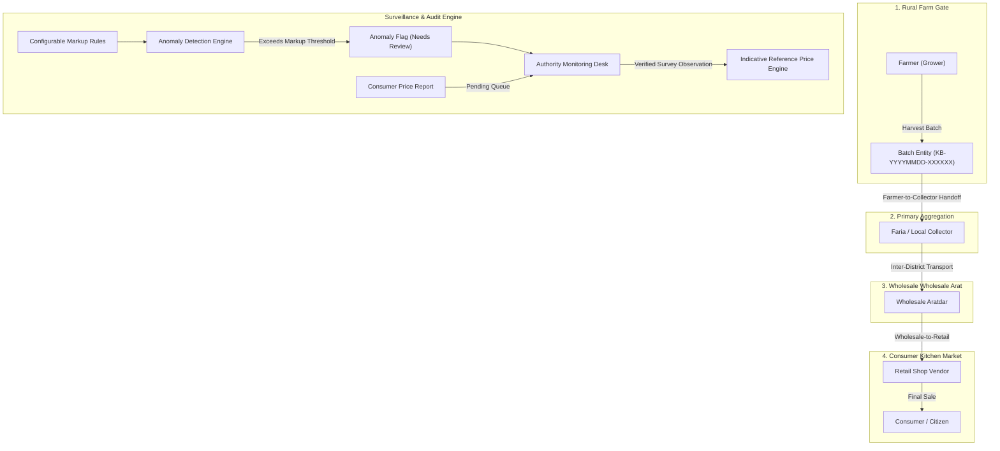
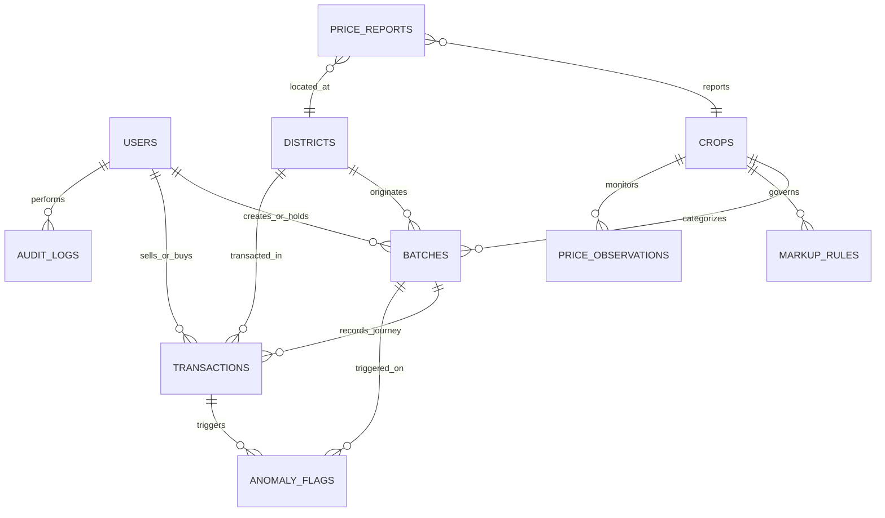

# KrishiByte — System Architecture & Domain Specifications

KrishiByte is a farm-to-retail agricultural supply chain tracking and market intelligence system designed for Bangladesh. It models physical agricultural lots as traceable digital batches that move across a sequential 4-stage custody pipeline.

---

## 1. Core Architecture Diagram

---

## 2. Database Entities & ER Diagram

### Table Definitions & Roles

1. **`users`**: RBAC identities (`admin`, `authority`, `farmer`, `collector`, `wholesale`, `retail`, `consumer`), account status, phone, NID/trade license.
2. **`districts`**: 13 major Bangladesh districts across all 8 divisions with GPS centroids.
3. **`crops`**: Crops (Potato, Onion, Tomato, Green Chili, Brinjal, Cauliflower, Rice) with grade and unit of measure.
4. **`batches`**: Digital batch with collision-safe code (`KB-YYYYMMDD-XXXXXX`), origin district, harvest date, initial farmer price, and `current_custodian_id`.
5. **`transactions`**: Immutable handoff events storing seller, buyer, stage, quantity, price per unit, gross price spread, markup %, and sequence number.
6. **`markup_rules`**: Configurable price spread guidelines per crop and stage.
7. **`anomaly_flags`**: Administrative tripwires triggered when measured markup exceeds active rules.
8. **`price_observations`**: Verified market surveys feeding indicative reference prices.
9. **`price_reports`**: Consumer submissions with optional photo and GPS coordinates, isolated in a private moderation queue until reviewed.
10. **`audit_logs`**: Chronological record of state transitions, actor ID, IP address, and payload diffs.
11. **`notifications`**: In-app alerts for flagged lots and moderation updates.

---

## 3. Mathematical Definitions & Price Calculations

To eliminate ambiguity between markups and margins, KrishiByte enforces exact formulas:

- **Previous Baseline Price ($B$):** The acquisition price per unit paid by the current seller in the preceding transaction (or initial farm-gate price for farmer transfers).
- **Current Sale Price ($S$):** The transfer price negotiated with the buyer.
- **Gross Price Spread:**
  $$\text{Spread} = S - B$$
- **Markup Percent on Cost (%):**
  $$\text{Markup} = \left(\frac{S - B}{B}\right) \times 100 \quad (B > 0)$$
- **Gross Margin Percent on Sale (%):**
  $$\text{Margin} = \left(\frac{S - B}{S}\right) \times 100 \quad (S > 0)$$
- **Pending Lots:** When a vendor holds custody of a lot and has not yet completed a sale to a downstream buyer, the system displays `"Pending next sale price"`. Speculative or invented profits are never displayed.

---

## 4. Indicative Reference Price Methodology

KrishiByte aggregates verified observations by crop, district, and date. To protect the public from artificial distortion or single-point manipulation:

1. **$\ge 5$ verified samples:** Computes a **20% trimmed mean** (discards top and bottom 20% outliers). Tagged as `High Confidence`.
2. **3 to 4 verified samples:** Computes the **median**. Tagged as `Medium Confidence`.
3. **$< 3$ verified samples:** Displays an untrimmed indicative average with an alert: `Insufficient verified data (Sample count: X)`.

---

## 5. Security & RBAC Enforcement

- **Server-Side Authorization:** Middleware `RoleMiddleware` inspects authenticated user roles before allowing access to `/farmer/*`, `/vendor/*`, `/authority/*`, and `/admin/*`. Hiding UI buttons is never treated as authorization.
- **Elevation Prevention:** Public registration routes permit selecting only `consumer`, `farmer`, `collector`, `wholesale`, or `retail`. Roles `authority` and `admin` are explicitly rejected.
- **Safe Evidence Uploads:** Evidence attachments are validated for MIME type (`image/jpeg`, `image/png`, `image/webp`), size ($\le 2$ MB), and stored with random SHA hashes.
- **Report Isolation:** Public users cannot view pending citizen reports or private reporter contact details. Only reviewed and verified reports are published.
